# DMA order-state flow

The order state records where an order stands between the algo's instruction and
the exchange's reports. Every operation classifies its pre-state before it does
anything.

## States

| value | state              | meaning                                                                                                           |
|-------|--------------------|-------------------------------------------------------------------------------------------------------------------|
| 0     | `STATE_UNKNOWN`    | Default, non-informative. Nothing has been recorded; not a valid pre-state for a launch.                          |
| 100   | `STATE_IDLE`       | The explicit initial state: the order is created and ready, not submitted. `c_dma_algo_engine_new_order` sets it. |
| 201   | `STATE_PENDING`    | Accepted by the DMA and queued; not yet handed to the launch handler. A cancel here is local.                     |
| 202   | `STATE_SENT`       | The launch handler has run and the order is out; the exchange has not confirmed it.                               |
| 300   | `STATE_PLACED`     | The exchange confirmed the order is placed. May be skipped when the order fills immediately.                      |
| 301   | `STATE_PARTFILLED` | Partially executed; the remainder is live.                                                                        |
| 302   | `STATE_FILLED`     | Fully executed. Terminal.                                                                                         |
| 400   | `STATE_CANCELING`  | The algo has instructed the cancel; the order is not yet actually cancelled.                                      |
| 401   | `STATE_CANCELED`   | The exchange confirmed the cancel. Terminal for the order state; says nothing about the fill record.              |
| 500   | `STATE_REJECTED`   | Refused by the launch check or by the exchange. Terminal.                                                         |
| 501   | `STATE_INVALID`    | Structurally malformed. Terminal; not produced by the flows below.                                                |

The numeric values are grouped by phase (0 unknown, 100 idle, 2xx submitted,
3xx live and executed, 4xx cancel, 5xx terminal refusal) and are not an
interface contract: code uses the enum names, never the literal value, so the
values may be re-spaced without a caller change.

`STATE_IDLE` is the explicit start. The launch moves it to `STATE_PENDING` in
queue mode or to `STATE_SENT` (or `STATE_REJECTED`) in direct mode.
`STATE_UNKNOWN` remains the non-informative default and is not a valid
pre-state for a launch.

`STATE_CANCELED` does not imply a partial fill, a full fill, or no fill. The
trade reports may still be incomplete when the cancel is confirmed. A fill
that arrives afterwards is booked and its callbacks run; it writes no state —
the state column follows the exchange's order-state event. The report protocol
is in `dma_algo_protocol.md`.

`STATE_CANCELING` lasts from the algo's cancel instruction until the actual
outcome: the exchange confirms the cancel, reports a full fill, or refuses the
cancel and leaves the order live. It is a working state, so a repeated cancel
on it is tolerated.

## Guard outcomes

Every operation that guards a pre-state classifies it into exactly one of three
classes. The three classes partition the eleven states for every such
operation. A fill is not one of them: the exchange report is authoritative and
the fill applies from every pre-state.

| class     | operation                                      | return                                              | output                                                                              |
|-----------|------------------------------------------------|-----------------------------------------------------|-------------------------------------------------------------------------------------|
| expected  | runs and produces the result in the flow table | the operation's code, `DMA_OK` or `DMA_OK_BUFFERED` | the handler runs where the result requires it                                       |
| tolerated | no operation                                   | `DMA_OK_NOOP`                                       | no handler; an operation may print a warning to make the tolerance visible          |
| banned    | no operation                                   | `DMA_ERR_INVALID_INPUT`                             | the cause to stderr; under `DMA_VIGILANT` the process stops with detailed telemetry |

`DMA_OK_NOOP` is a positive code distinct from `DMA_OK` and `DMA_OK_BUFFERED`,
so a caller can tell a deliberate no-op from a performed operation.
`DMA_VIGILANT` is a compile-time macro with default 0.

## State predicates

The order-state predicates live in `c_market_data.h` beside `md_order_state`:
`c_md_state_working`, `c_md_state_placed`, `c_md_state_done` and
`c_md_state_cancellable`. `c_dma.h` consumes them; it does not define its own
state predicate. `c_md_state_cancellable` is the exchange-live cancel predicate:
`STATE_SENT`, `STATE_PLACED` or `STATE_PARTFILLED`.

## Flows

### Launch — `c_dma_launch_order`

| class     | pre-states                                                                                                                                                | outcome                                                                             |
|-----------|-----------------------------------------------------------------------------------------------------------------------------------------------------------|-------------------------------------------------------------------------------------|
| expected  | `STATE_IDLE`                                                                                                                                              | `STATE_PENDING` when queued; `STATE_SENT` or `STATE_REJECTED` when dispatched       |
| tolerated | `STATE_PENDING`                                                                                                                                           | no operation; `DMA_OK_NOOP`; warning: the order is already queued (queue mode only) |
| banned    | `STATE_UNKNOWN`, `STATE_SENT`, `STATE_PLACED`, `STATE_PARTFILLED`, `STATE_CANCELING`, `STATE_FILLED`, `STATE_CANCELED`, `STATE_REJECTED`, `STATE_INVALID` | no operation; `DMA_ERR_INVALID_INPUT`; stderr; `DMA_VIGILANT` stop                  |

`STATE_IDLE` is the explicit start from `c_dma_algo_engine_new_order`; the
launch is the only entry that moves it forward. `STATE_PENDING` is tolerated
because the launch is already queued; a repeated launch must not queue it
twice. The branch exists only in queue mode and prints
`[DMA] WARNING: launch ignored; order <id> is already queued` so the repeat is
visible. `STATE_UNKNOWN` is banned because the order never went through the
engine.

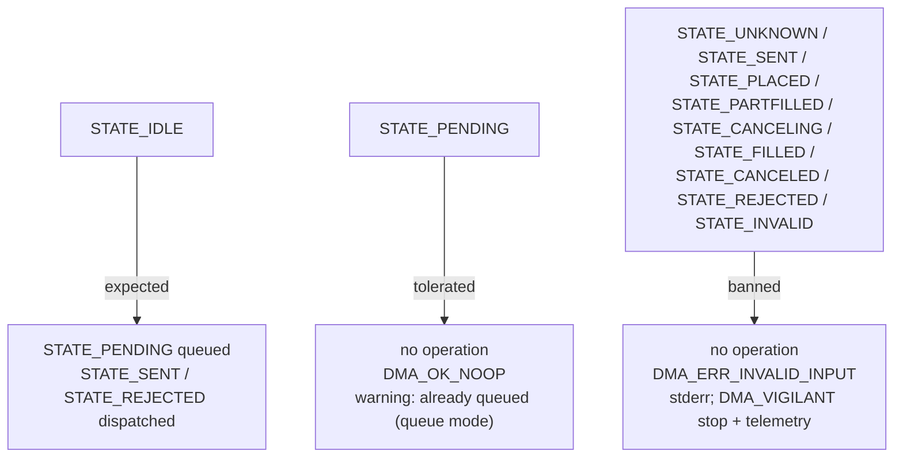

### Launch unchecked — `c_dma_launch_order_unchecked`

| class     | pre-states                                                                                                                                                                 | outcome                                                            |
|-----------|----------------------------------------------------------------------------------------------------------------------------------------------------------------------------|--------------------------------------------------------------------|
| expected  | `STATE_IDLE`                                                                                                                                                               | `STATE_SENT`, no check, warning on stderr                          |
| tolerated | none                                                                                                                                                                       | —                                                                  |
| banned    | `STATE_UNKNOWN`, `STATE_PENDING`, `STATE_SENT`, `STATE_PLACED`, `STATE_PARTFILLED`, `STATE_CANCELING`, `STATE_FILLED`, `STATE_CANCELED`, `STATE_REJECTED`, `STATE_INVALID` | no operation; `DMA_ERR_INVALID_INPUT`; stderr; `DMA_VIGILANT` stop |

The unchecked entry bypasses the check and the queue, not the state contract.
A `STATE_PENDING` order is already queued; the unchecked path is the last safety
net and bans it rather than sending it again. `STATE_UNKNOWN` is banned because
the order was never initialized.

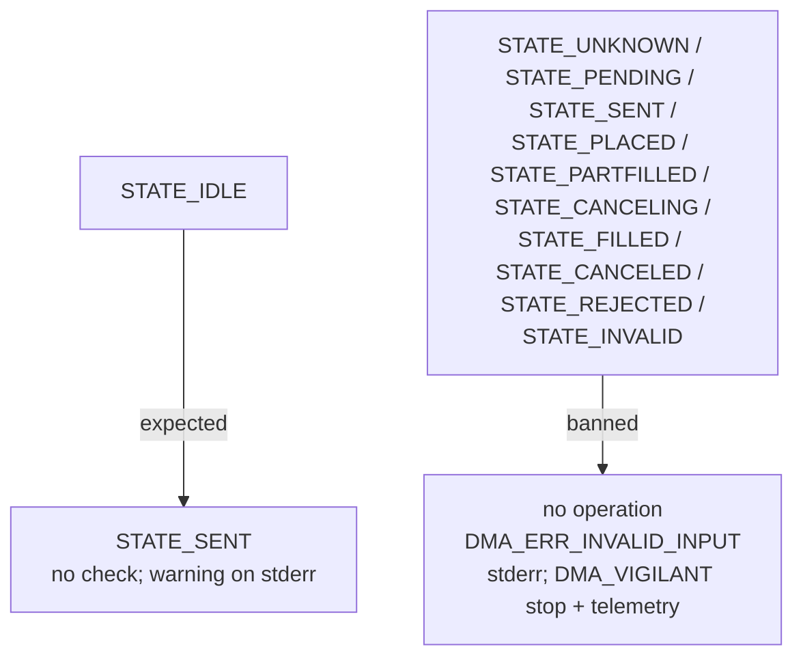

### Launch dispatch — `c_dma_process_queue`

| class     | pre-states                                                                                                                            | outcome                                                            |
|-----------|---------------------------------------------------------------------------------------------------------------------------------------|--------------------------------------------------------------------|
| expected  | `STATE_PENDING`                                                                                                                       | `STATE_SENT` or `STATE_REJECTED`; the launch handler runs          |
| tolerated | `STATE_CANCELED`, `STATE_PLACED`                                                                                                      | no operation; `DMA_OK_NOOP`; the launch handler never runs         |
| banned    | `STATE_IDLE`, `STATE_UNKNOWN`, `STATE_SENT`, `STATE_PARTFILLED`, `STATE_CANCELING`, `STATE_FILLED`, `STATE_REJECTED`, `STATE_INVALID` | no operation; `DMA_ERR_INVALID_INPUT`; stderr; `DMA_VIGILANT` stop |

A `STATE_CANCELED` order must never be sent, but the pre-state is a tolerated
no-op: the dispatch drops the stale entry and the launch handler is never
called. `STATE_PLACED` is the same case for an order placed from another
interface while it was still queued. An `STATE_IDLE` entry means the launch
transition was bypassed, so it is banned.

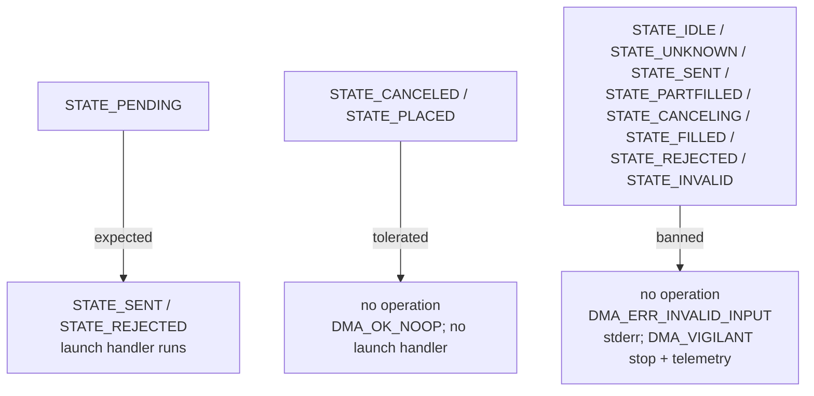

### Cancel — `c_dma_cancel_order`

| class     | pre-states                                                                           | outcome                                                            |
|-----------|--------------------------------------------------------------------------------------|--------------------------------------------------------------------|
| expected  | `STATE_IDLE`, `STATE_PENDING`                                                        | `STATE_CANCELED` locally; no payload, no handler                   |
| expected  | `STATE_SENT`, `STATE_PLACED`, `STATE_PARTFILLED`                                     | `STATE_CANCELING`; direct handler or queued cancel payload         |
| tolerated | `STATE_CANCELING`                                                                    | no operation; `DMA_OK_NOOP`                                        |
| banned    | `STATE_UNKNOWN`, `STATE_FILLED`, `STATE_CANCELED`, `STATE_REJECTED`, `STATE_INVALID` | no operation; `DMA_ERR_INVALID_INPUT`; stderr; `DMA_VIGILANT` stop |

`STATE_IDLE` and `STATE_PENDING` have not left the DMA, so the cancel revokes
them locally and nothing is sent. The live states use
`c_md_state_cancellable`. `STATE_CANCELING` is tolerated because the order is
working and the cancel is already in progress; a repeated cancel changes
nothing. The terminal states and `STATE_UNKNOWN` have nothing to cancel.

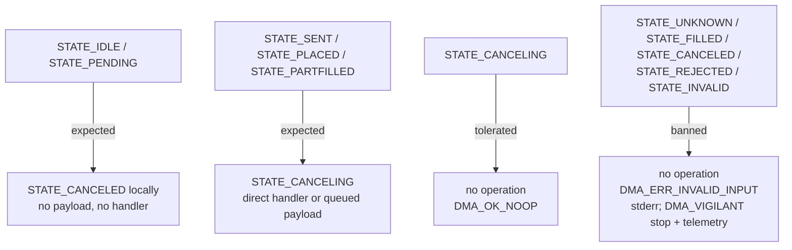

### Cancel dispatch — `c_dma_process_queue`

| class     | pre-states                                                                                                                          | outcome                                                            |
|-----------|-------------------------------------------------------------------------------------------------------------------------------------|--------------------------------------------------------------------|
| expected  | `STATE_CANCELING`                                                                                                                   | stays `STATE_CANCELING`; the cancel handler runs                   |
| tolerated | `STATE_FILLED`, `STATE_CANCELED`                                                                                                    | drop the entry; `DMA_OK_NOOP`                                      |
| banned    | `STATE_IDLE`, `STATE_UNKNOWN`, `STATE_PENDING`, `STATE_SENT`, `STATE_PLACED`, `STATE_PARTFILLED`, `STATE_REJECTED`, `STATE_INVALID` | no operation; `DMA_ERR_INVALID_INPUT`; stderr; `DMA_VIGILANT` stop |

`STATE_FILLED` and `STATE_CANCELED` are resolved orders: the queued cancel is
moot and is dropped silently.

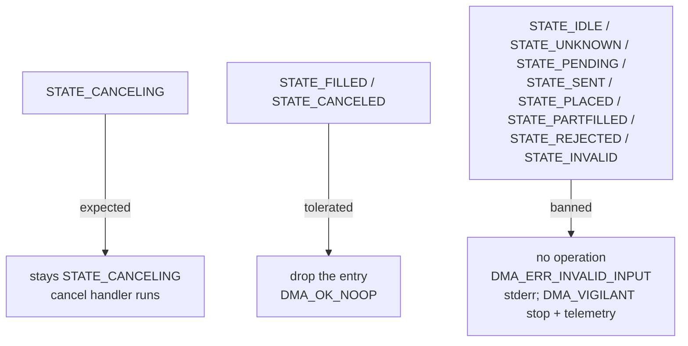

### Reject, local — the launch check fails

| class     | pre-states                                                                                                                                            | outcome                                                            |
|-----------|-------------------------------------------------------------------------------------------------------------------------------------------------------|--------------------------------------------------------------------|
| expected  | `STATE_PENDING`                                                                                                                                       | `STATE_REJECTED`; the rejected callback runs                          |
| tolerated | `STATE_REJECTED`                                                                                                                                      | no operation; `DMA_OK_NOOP`                                        |
| banned    | `STATE_IDLE`, `STATE_UNKNOWN`, `STATE_SENT`, `STATE_PLACED`, `STATE_PARTFILLED`, `STATE_CANCELING`, `STATE_FILLED`, `STATE_CANCELED`, `STATE_INVALID` | no operation; `DMA_ERR_INVALID_INPUT`; stderr; `DMA_VIGILANT` stop |

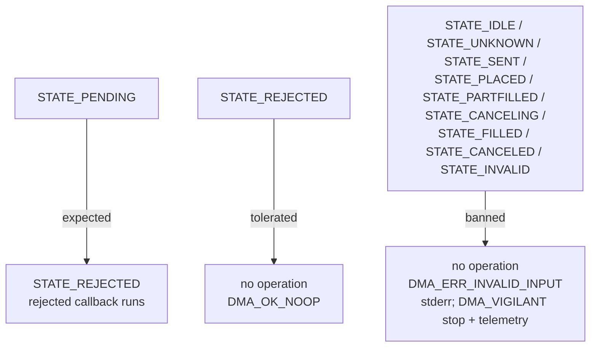

### Reject, exchange

| class     | pre-states                                                                                                                                               | outcome                                                            |
|-----------|----------------------------------------------------------------------------------------------------------------------------------------------------------|--------------------------------------------------------------------|
| expected  | `STATE_SENT`                                                                                                                                             | `STATE_REJECTED`; the rejected callback runs                          |
| tolerated | `STATE_REJECTED`                                                                                                                                         | no operation; `DMA_OK_NOOP`                                        |
| banned    | `STATE_IDLE`, `STATE_UNKNOWN`, `STATE_PENDING`, `STATE_PLACED`, `STATE_PARTFILLED`, `STATE_CANCELING`, `STATE_FILLED`, `STATE_CANCELED`, `STATE_INVALID` | no operation; `DMA_ERR_INVALID_INPUT`; stderr; `DMA_VIGILANT` stop |

A refused cancel is not this operation.

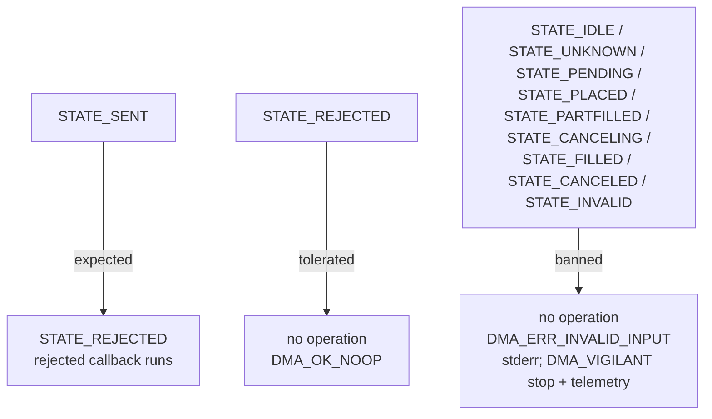

### Placed — the exchange confirms the order

| class     | pre-states                                                                              | outcome                                                            |
|-----------|-----------------------------------------------------------------------------------------|--------------------------------------------------------------------|
| expected  | `STATE_IDLE`, `STATE_PENDING`, `STATE_SENT`                                             | `STATE_PLACED`                                                     |
| tolerated | `STATE_PLACED`, `STATE_PARTFILLED`, `STATE_FILLED`, `STATE_CANCELING`, `STATE_CANCELED` | no operation; `DMA_OK_NOOP`                                        |
| banned    | `STATE_UNKNOWN`, `STATE_REJECTED`, `STATE_INVALID`                                      | no operation; `DMA_ERR_INVALID_INPUT`; stderr; `DMA_VIGILANT` stop |

The exchange's placed confirmation is authoritative: it moves an order the DMA
still sees as `STATE_IDLE` (created), `STATE_PENDING` (queued) or `STATE_SENT`
to `STATE_PLACED`. Later states are a late or duplicate acknowledgement and are
tolerated.

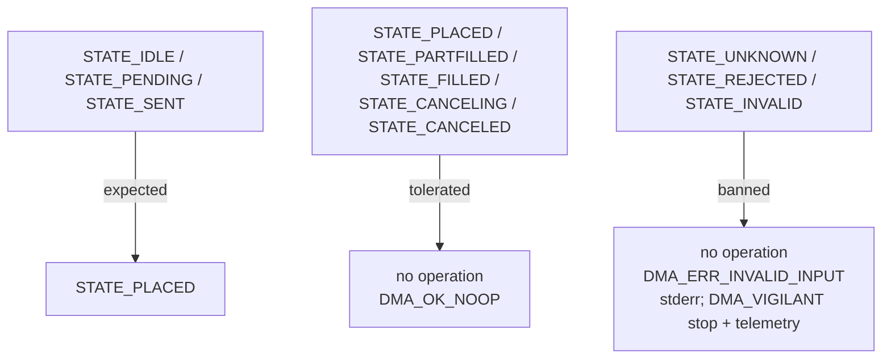

### Fill — a trade report without `OFFSET_CANCEL`

| class     | pre-states  | outcome                                                                                       |
|-----------|-------------|-----------------------------------------------------------------------------------------------|
| expected  | every state | the volume, notional and fee are booked; the `on_filled` callbacks and the position mirror run |
| tolerated | none        | —                                                                                             |
| banned    | none        | —                                                                                             |

A fill is identified by its trade side, not by its volume: a trade report whose
side offset is not `OFFSET_CANCEL` is a fill. It applies from every pre-state —
the exchange report is authoritative — and it writes no order state: the state
column follows the order-state event. The trade-id dedup is the only gate, so
a repeated report is a no-op. The protocol is in `dma_algo_protocol.md`.

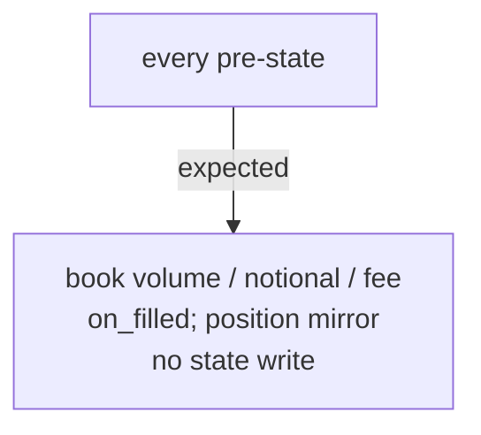

### Cancel confirmation — the exchange confirms the cancel

The confirmation comes from exactly two sources: an order-state event carrying
`STATE_CANCELED`, or a trade report whose side carries `OFFSET_CANCEL`. The
volume is never the indication, and a cancel report may carry a positive volume
(the canceled amount); that amount is not booked as a fill.

| class     | pre-states                                                                                        | outcome                                                            |
|-----------|---------------------------------------------------------------------------------------------------|--------------------------------------------------------------------|
| expected  | `STATE_CANCELING`                                                                                 | `STATE_CANCELED`                                                   |
| expected  | `STATE_SENT`, `STATE_PLACED`, `STATE_PARTFILLED`                                                  | `STATE_CANCELED`; an external cancel the DMA did not mark          |
| tolerated | `STATE_CANCELED`                                                                                  | no operation; `DMA_OK_NOOP`                                        |
| banned    | `STATE_IDLE`, `STATE_UNKNOWN`, `STATE_PENDING`, `STATE_FILLED`, `STATE_REJECTED`, `STATE_INVALID` | no operation; `DMA_ERR_INVALID_INPUT`; stderr; `DMA_VIGILANT` stop |

The exchange's cancel confirmation is authoritative: an order canceled from
another interface completes from `STATE_SENT`, `STATE_PLACED` or
`STATE_PARTFILLED` even though the DMA never marked `STATE_CANCELING`.
`STATE_FILLED` is the critical ban: a cancel confirmation must never override a
full fill.

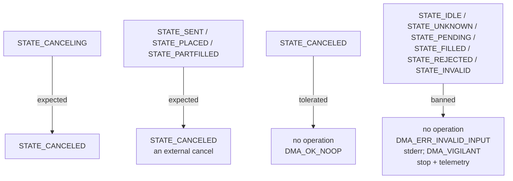

### Cancel refused — the exchange refuses the cancel

| class     | pre-states                                                                                          | outcome                                                                                  |
|-----------|-----------------------------------------------------------------------------------------------------|------------------------------------------------------------------------------------------|
| expected  | `STATE_CANCELING`                                                                                   | the live state carried by the report: `STATE_SENT`, `STATE_PLACED` or `STATE_PARTFILLED` |
| tolerated | `STATE_SENT`, `STATE_PLACED`, `STATE_PARTFILLED`                                                    | no operation; `DMA_OK_NOOP`; the order is already live                                   |
| tolerated | `STATE_FILLED`                                                                                      | no operation; `DMA_OK_NOOP`; the order filled, the refusal is moot                       |
| banned    | `STATE_IDLE`, `STATE_UNKNOWN`, `STATE_PENDING`, `STATE_CANCELED`, `STATE_REJECTED`, `STATE_INVALID` | no operation; `DMA_ERR_INVALID_INPUT`; stderr; `DMA_VIGILANT` stop                       |

A cancel refused from another interface leaves the order live; when the DMA
already sees `STATE_SENT`, `STATE_PLACED` or `STATE_PARTFILLED`, the refusal is
a no-op. A refused cancel needs a report that carries the live state, because
`STATE_CANCELING` overwrites the pre-cancel state.

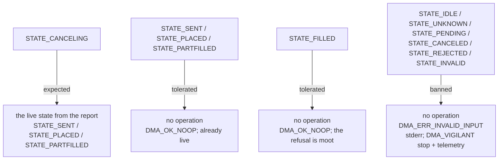

## Boundaries

The dry run, `c_dma_check_order`, changes no state; it has no pre-state guard.

`STATE_IDLE` is the explicit start and `STATE_UNKNOWN` is not a valid launch
pre-state. `STATE_PENDING` is not exchange-live: a cancel on it is local and marks
the order `STATE_CANCELED`; the queue processor tolerates the stale entry
without calling the launch handler. `STATE_INVALID` is terminal and outside
these flows.
